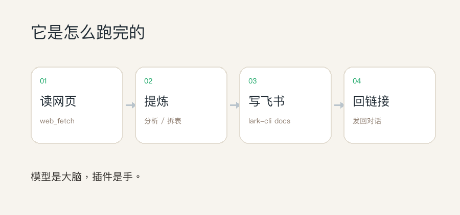
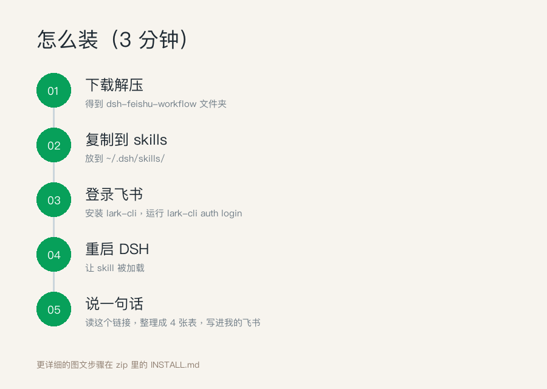

# DSH 飞书工作流 · 演示

一句话：**读网页 → 分析 → 写飞书 → 回链接**。

> 完整安装包 **9.9 元**，在公众号文章内获取。

> 这是演示页。完整安装包（skill + 3 个飞书模板 + 3 分钟安装指南）在公众号付费文章获取。

## 它做什么

- 读取网页/长文，提炼成结构化表格或报告
- 生成飞书云文档，自动把链接发回对话
- 支持对比表、清单、复盘报告

## 演示

## 获取完整版

👉 **[点这里阅读公众号文章](https://mp.weixin.qq.com/s/4H-M_nh6fpMILPN_eToQWQ)**

9.9 元解锁，包含：

- 可复用的 skill（`dsh-feishu-workflow`）
- 3 个飞书文档模板
- 3 分钟安装指南
- 常见问题（登录 / 权限 / 网络）

### 扫码阅读

## 为什么收费

安装包本身不大，值钱的是：

- 已经踩过的坑（`lark-cli` 授权、飞书权限、路径）
- 3 个能直接套用的模板
- 后续更新

## License

MIT
